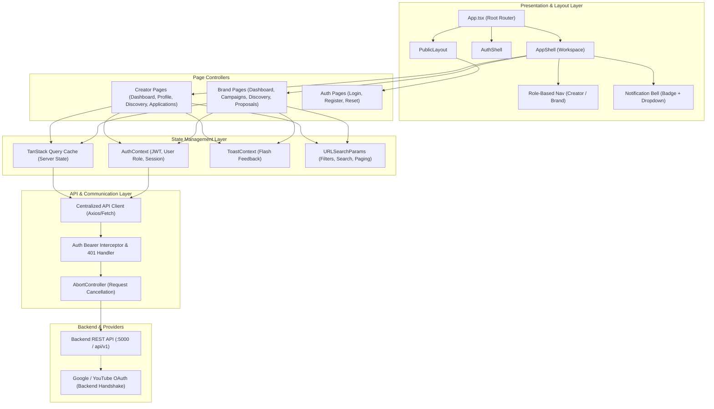
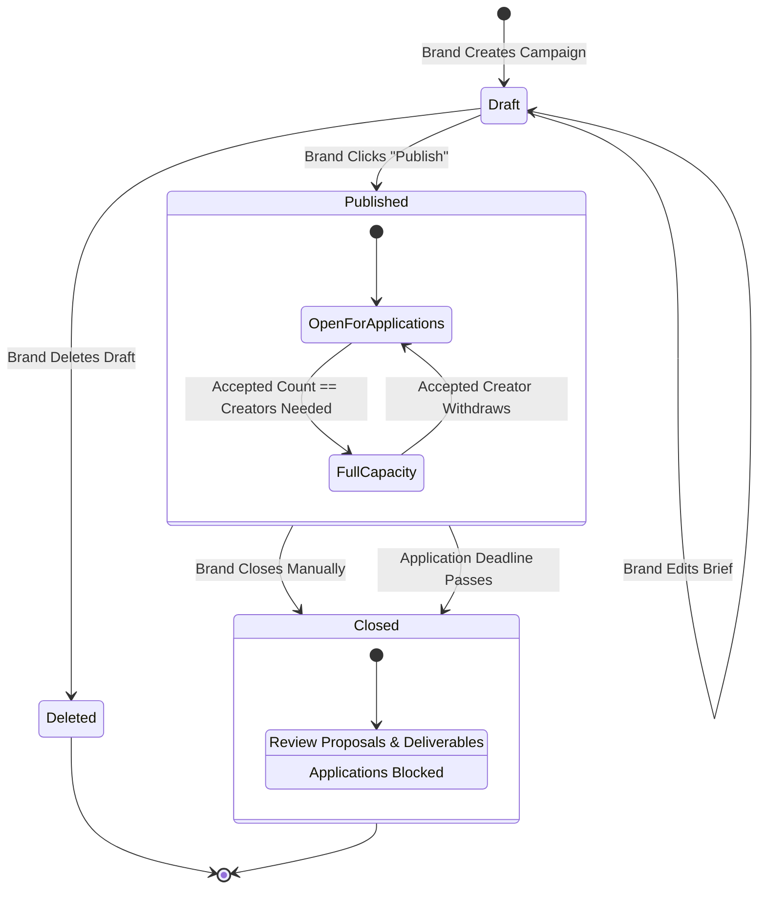
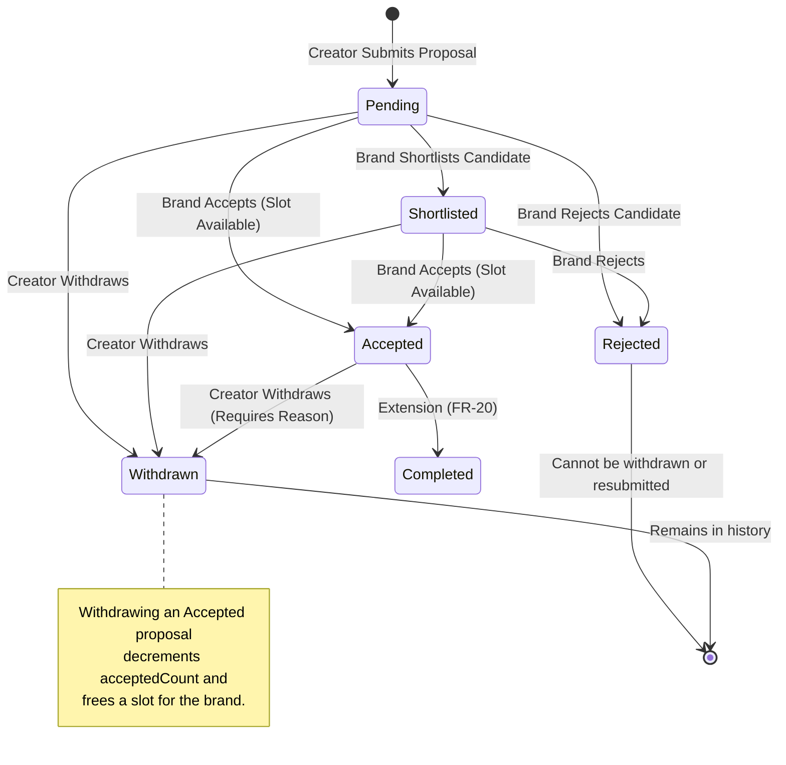
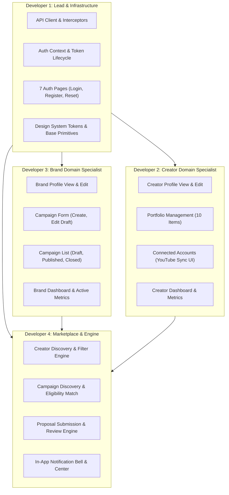

# Frontend System Design and Implementation Specification
## Project: Micro-Influencers’ Platform

**Version:** 1.0.0  
**Status:** Approved for Implementation  
**Target Delivery Date:** October 23, 2026  
**Document Authors:** Senior Frontend Architect, React Engineer, UI/UX Designer, Technical Documentation Specialist  
**Target Audience:** Frontend Engineering Team (4 Developers), Backend Engineer, Product Management, QA  

---

## Table of Contents
1. [Executive Summary & Project Context](#1-executive-summary--project-context)
2. [A. Frontend Architecture](#a-frontend-architecture)
   - 2.1 [Architecture Overview & Technology Stack](#21-architecture-overview--technology-stack)
   - 2.2 [Component & Page Hierarchy](#22-component--page-hierarchy)
   - 2.3 [Routing Structure & Access Control](#23-routing-structure--access-control)
   - 2.4 [Shared Layouts & Composition Pattern](#24-shared-layouts--composition-pattern)
   - 2.5 [Separation of Concerns (Presentation vs. Container vs. API)](#25-separation-of-concerns)
   - 2.6 [Recommended Directory Structure](#26-recommended-directory-structure)
   - 2.7 [Mermaid Architecture Diagrams](#27-mermaid-architecture-diagrams)
3. [B. Page and Route Specification](#b-page-and-route-specification)
   - 3.1 [Comprehensive Route Matrix Table](#31-comprehensive-route-matrix-table)
   - 3.2 [Route Security & Guards](#32-route-security--guards)
4. [C. UI/UX Design System](#c-uiux-design-system)
   - 4.1 [Brand Identity & Design Philosophy](#41-brand-identity--design-philosophy)
   - 4.2 [Color Palette & Semantic Token Mapping](#42-color-palette--semantic-token-mapping)
   - 4.3 [Typography Scale](#43-typography-scale)
   - 4.4 [Spacing, Elevation & Layout Grid](#44-spacing-elevation--layout-grid)
   - 4.5 [Responsive Breakpoints](#45-responsive-breakpoints)
   - 4.6 [Base Component Anatomy](#46-base-component-anatomy)
   - 4.7 [Form Feedback & Validation Visuals](#47-form-feedback--validation-visuals)
   - 4.8 [Accessibility Standards (WCAG 2.1 AA)](#48-accessibility-standards-wcag-21-aa)
   - 4.9 [Cross-Role Interface Consistency](#49-cross-role-interface-consistency)
5. [D. Component Design & Reusable Library](#d-component-design--reusable-library)
   - 5.1 [Component Matrix & Props Specifications](#51-component-matrix--props-specifications)
   - 5.2 [Deep-Dive Reusable Component Specifications](#52-deep-dive-reusable-component-specifications)
6. [E. Frontend State Management Architecture](#e-frontend-state-management-architecture)
   - 6.1 [State Taxonomy & Clear Boundaries](#61-state-taxonomy--clear-boundaries)
   - 6.2 [Current State Evaluation vs. Production Architecture](#62-current-state-evaluation-vs-production-architecture)
   - 6.3 [TanStack Query Integration & Caching Strategy](#63-tanstack-query-integration--caching-strategy)
   - 6.4 [Query Keys & Cache Invalidation Workflow](#64-query-keys--cache-invalidation-workflow)
   - 6.5 [Single Source of Truth Enforcement](#65-single-source-of-truth-enforcement)
7. [F. API Integration Contract](#f-api-integration-contract)
   - 7.1 [Centralized API Client Architecture](#71-centralized-api-client-architecture)
   - 7.2 [Proposed API Endpoint Contract (Unconfirmed)](#72-proposed-api-endpoint-contract-unconfirmed)
   - 7.3 [Authentication & Session Lifecycle](#73-authentication--session-lifecycle)
   - 7.4 [Standardized Error Handling & Normalization](#74-standardized-error-handling--normalization)
   - 7.5 [Request Cancellation, Timeouts & Retries](#75-request-cancellation-timeouts--retries)
   - 7.6 [Pagination, Search & Filter Conventions](#76-pagination-search--filter-conventions)
8. [G. Forms and Validation Specifications](#g-forms-and-validation-specifications)
   - 8.1 [Form Rules, Validation & Error Feedback Matrix](#81-form-rules-validation--error-feedback-matrix)
   - 8.2 [Duplicate Submission Prevention Pattern](#82-duplicate-submission-prevention-pattern)
9. [H. Role and Workflow Handling](#h-role-and-workflow-handling)
   - 9.1 [Role-Based Access & Unauthorized Traps](#91-role-based-access--unauthorized-traps)
   - 9.2 [Campaign Lifecycle State Machine](#92-campaign-lifecycle-state-machine)
   - 9.3 [Proposal Status State Machine & Capacity Enforcement](#93-proposal-status-state-machine--capacity-enforcement)
   - 9.4 [Proposal Withdrawal & Slot Reopening Workflow](#94-proposal-withdrawal--slot-reopening-workflow)
   - 9.5 [Deadline Expiration & In-App Notification Flow](#95-deadline-expiration--in-app-notification-flow)
   - 9.6 [Mermaid Workflow & State Diagrams](#96-mermaid-workflow--state-diagrams)
10. [I. Responsive Design and Accessibility (A11y)](#i-responsive-design-and-accessibility-a11y)
    - 10.1 [Responsive Strategies by Breakpoint](#101-responsive-strategies-by-breakpoint)
    - 10.2 [Adaptive Layouts (Cards, Tables, Drawers)](#102-adaptive-layouts-cards-tables-drawers)
    - 10.3 [A11y Implementation: Keyboard, Focus Traps & ARIA](#103-a11y-implementation-keyboard-focus-traps--aria)
11. [J. Frontend Security Architecture](#j-frontend-security-architecture)
    - 11.1 [Safe Rendering of User-Generated Content (XSS Prevention)](#111-safe-rendering-of-user-generated-content-xss-prevention)
    - 11.2 [External URL Sanitization & Link Hardening](#112-external-url-sanitization--link-hardening)
    - 11.3 [Token Storage & Browser Security](#113-token-storage--browser-security)
    - 11.4 [Environment Variables & Secret Hygiene](#114-environment-variables--secret-hygiene)
12. [K. Error, Loading, and Empty States Architecture](#k-error-loading-and-empty-states-architecture)
    - 12.1 [Reusable State Patterns](#121-reusable-state-patterns)
    - 12.2 [Visual Specifications for Skeletons, Errors & Zero-States](#122-visual-specifications-for-skeletons-errors--zero-states)
13. [L. Testing Strategy](#l-testing-strategy)
    - 13.1 [Testing Hierarchy & Tooling Setup](#131-testing-hierarchy--tooling-setup)
    - 13.2 [Unit & Component Tests](#132-unit--component-tests)
    - 13.3 [Integration & Mock Service Worker (MSW) Tests](#133-integration--mock-service-worker-msw-tests)
    - 13.4 [End-to-End User Journey Tests](#134-end-to-end-user-journey-tests)
    - 13.5 [Formal Acceptance Criteria by Workflow](#135-formal-acceptance-criteria-by-workflow)
14. [M. Frontend Team Task Breakdown (4 Developers)](#m-frontend-team-task-breakdown-4-developers)
    - 14.1 [Team Roles & Ownership Boundaries](#141-team-roles--ownership-boundaries)
    - 14.2 [Developer 1: Foundation, Auth & Infrastructure](#142-developer-1-foundation-auth--infrastructure)
    - 14.3 [Developer 2: Creator Domain Specialist](#143-developer-2-creator-domain-specialist)
    - 14.4 [Developer 3: Brand Domain Specialist](#144-developer-3-brand-domain-specialist)
    - 14.5 [Developer 4: Discovery, Proposals & Notifications](#145-developer-4-discovery-proposals--notifications)
    - 14.6 [Shared Git Workflow & Conflict Prevention Conventions](#146-shared-git-workflow--conflict-prevention-conventions)
15. [N. Vercel Deployment and Integration](#n-vercel-deployment-and-integration)
    - 15.1 [Environment Configuration](#151-environment-configuration)
    - 15.2 [Vercel SPA Routing Configuration (`vercel.json`)](#152-vercel-spa-routing-configuration-verceljson)
    - 15.3 [API CORS Coordination](#153-api-cors-coordination)
    - 15.4 [Build Pipeline & Quality Gates](#154-build-pipeline--quality-gates)
    - 15.5 [Preview Deployments, Smoke Tests & Rollback Plan](#155-preview-deployments-smoke-tests--rollback-plan)
16. [O. Implementation Gap Analysis](#o-implementation-gap-analysis)
    - 16.1 [Granular Requirement Audit (PRD vs Codebase)](#161-granular-requirement-audit-prd-vs-codebase)
    - 16.2 [Next Immediate Steps for Frontend Team](#162-next-immediate-steps-for-frontend-team)
17. [Appendix: Open Questions for the Backend Team](#appendix-open-questions-for-the-backend-team)
18. [Prioritized Implementation Checklist](#prioritized-implementation-checklist)

---

## 1. Executive Summary & Project Context

### 1.1 Project Mission
The **Micro-Influencers’ Platform** (internally branded as *Microwork*) is a specialized two-sided marketplace tailored specifically for creators with micro-tier followings (1,000 to 100,000 followers) and small-to-medium enterprise (SME) brands. 

The primary business value is eliminating the friction of manual influencer marketing:
- **For Brands:** Discovering verified, niche-relevant talent without tedious manual DM outreach; posting structured campaign briefs; and managing candidate proposals through an atomic selection pipeline.
- **For Creators:** Maintaining a verifiable rate card, showcasing external portfolio work, proving legitimate audience reach via read-only YouTube OAuth syncing, and directly applying to funded brand campaigns without intermediation.

### 1.2 Team Structure and Constraints
- **Team Composition:** 4 Frontend Engineers and 1 Backend Engineer.
- **Target Deadline:** October 23, 2026 (~3.5-week delivery cycle).
- **Core Constraints:**
  - Separate repositories for frontend and backend.
  - Strict scope control: zero out-of-scope feature creep (no built-in payment escrow/processing, no live direct messaging chat, no raw video/image file uploads to server, no Meta/TikTok OAuth app submissions, and no WebSockets/push notifications).
  - Clear separation between UI-implemented prototypes and verified backend API integration.

### 1.3 Codebase Audit Summary
A comprehensive audit of the existing repository (`microinf-platform`) reveals that the application is built on **React 18.3.1**, **Vite 5.4.8**, **TypeScript 5.6.2**, and **Tailwind CSS 3.4.13**. 
- The current implementation boasts high visual polish and complete route structures (22 distinct pages).
- **Critical Technical Finding:** The platform currently operates **entirely on client-side mock data** managed through a custom module-level pub/sub in-memory/localStorage store (`src/state/Store.ts` and `src/state/AuthContext.tsx`).
- **No real API communication exists today:** There are zero `fetch` or `axios` calls, zero environment variables connecting to a backend, and simulated network delays using `setTimeout`.
- **Primary Objective of this Design Document:** Provide the architectural blueprint to transition the frontend team from mock-driven prototypes to a robust, type-safe, resilient client integrating with the backend API while preserving existing UI excellence.

---

## A. Frontend Architecture

### 2.1 Architecture Overview & Technology Stack
The application adheres to modern React SPA architecture principles:

```
+-----------------------------------------------------------------------------------+
|                                 Browser (SPA)                                     |
|  +-----------------------------------------------------------------------------+  |
|  |                             Presentation Layer                              |  |
|  |    Pages (Route Endpoints)  <--->  Feature Components  <--->  Design System |  |
|  +-----------------------------------------------------------------------------+  |
|                                        |                                          |
|  +-----------------------------------------------------------------------------+  |
|  |                             Container / Hook Layer                          |  |
|  |    Custom Hooks (useCampaigns, useProposals, useDiscovery, useAuth)         |  |
|  +-----------------------------------------------------------------------------+  |
|                                        |                                          |
|  +-----------------------------------------------------------------------------+  |
|  |                            Client State Architecture                        |  |
|  |  +------------------------+  +-------------------+  +--------------------+  |  |
|  |  | TanStack Query v5      |  | React Context API |  | URL SearchParams   |  |  |
|  |  | (Server State & Cache) |  | (Auth, Toasts)    |  | (Filters, Paging)  |  |  |
|  |  +------------------------+  +-------------------+  +--------------------+  |  |
|  +-----------------------------------------------------------------------------+  |
|                                        |                                          |
|  +-----------------------------------------------------------------------------+  |
|  |                              Data Access Layer                              |  |
|  |    Centralized API Client (Axios/Fetch Wrapper) + Interceptors + DTO Types  |  |
|  +-----------------------------------------------------------------------------+  |
+----------------------------------------|------------------------------------------+
                                         | HTTPS (JSON / Bearer Token)
                                         v
                      +-------------------------------------+
                      |       Backend REST API Engine       |
                      +-------------------------------------+
```

#### Core Technology Stack:
- **Core Runtime & UI:** React 18.3 (`createRoot`, React Hooks, Suspense).
- **Build System & Tooling:** Vite 5.4 + `@vitejs/plugin-react` + TypeScript 5.6.
- **Routing:** React Router v6.26 (`createBrowserRouter` or declarative `<Routes>` with nested `<Outlet>` layouts).
- **Styling & Design System:** Tailwind CSS 3.4 with custom Upwork-inspired brand palette, custom animations, and utility extensions.
- **Icons:** `lucide-react` 0.453.
- **Server State & Caching Layer (Recommended Migration):** TanStack Query v5 (`@tanstack/react-query`).
- **HTTP Client (Recommended):** Centralized fetch wrapper or Axios 1.7 with abort signals and type-safe response interceptors.
- **Deployment Platform:** Vercel (Edge network, SPA rewrite routing via `vercel.json`).

### 2.2 Component & Page Hierarchy
The application hierarchy strictly enforces layout encapsulation:
1. **Root (`main.tsx` -> `App.tsx`):** Provides global providers (`QueryClientProvider`, `AuthProvider`, `ToastProvider`, `BrowserRouter`).
2. **Layout Wrappers:**
   - `PublicLayout`: Unauthenticated wrapper hosting sticky public header, hero navigation, and marketing footer.
   - `AuthShell`: Focused, distraction-free authentication wrapper featuring side-by-side branded splash art and centered responsive card.
   - `AppShell`: Authenticated master workspace hosting sticky top navigation bar (logo, global quick-search, quick-actions button, notification bell with unread badge, avatar menu), responsive collapsible sidebar drawer, and page transition `<main>` container.
3. **Route Components (`src/pages/**`):** Route endpoints orchestrating data fetching, passing clean props down to pure UI components.
4. **Domain Components (`src/components/**`):** Modular domain building blocks (e.g., `CampaignCard`, `CreatorCard`, `ProposalManagementRow`).
5. **Base Design System (`src/components/ui.tsx`, `Modal.tsx`):** Atomic, headless-compatible UI components (`Button`, `Input`, `Textarea`, `Select`, `FormField`, `Badge`, `EmptyState`, `Skeleton`, `Modal`, `ConfirmDialog`).

### 2.3 Routing Structure & Access Control
Routing is subdivided into four isolated zones:
- **Public Zone:** Accessible to anyone (`/`, `/login`, `/register/*`, `/forgot-password`, `/verify-code`, `/reset-password`).
- **Creator Zone:** Protected by `Protected role="creator"`. Redirects unauthenticated users to `/login` and brands to `/unauthorized`.
- **Brand Zone:** Protected by `Protected role="brand"`. Redirects unauthenticated users to `/login` and creators to `/unauthorized`.
- **Shared Authenticated Zone:** Error boundaries, 404 handler, and role-adaptive pages (`/notifications`).

### 2.4 Shared Layouts & Composition Pattern
The application uses React Router’s nested route pattern (`<Outlet />`).
- **Elimination of layout flashing:** When navigating between `/creator/dashboard` and `/creator/campaigns`, the `AppShell` header and sidebar remain permanently mounted; only the interior `<Outlet />` executes smooth entrance transitions (`anim-page-in`).
- **Context boundary isolation:** Modal dialogs and toast viewports are portal-rendered to `document.body` to avoid clipping issues caused by parent overflow properties (`overflow-hidden` or `overflow-y-auto`).

### 2.5 Separation of Concerns
To allow four developers to collaborate without merge collisions:
- **Presentation Components (`src/components/*`):** Purely deterministic UI. Accept props, emit events, declare zero direct side-effects, and never call API functions directly.
- **Container / Page Components (`src/pages/*`):** Read route parameters, execute query hooks, handle error states, and delegate rendering to presentation components.
- **API Services (`src/api/*`):** Isolated functions mapping REST endpoints to TypeScript models. No React hooks or JSX allowed in this layer.
- **Custom Hooks (`src/hooks/*`):** Reusable business logic (e.g., `useCampaignEligibility`, `useDebounce`, `useProposalActions`).

### 2.6 Recommended Directory Structure
Reflecting the existing codebase while expanding for API integration, testing, and multi-developer scale:

```
microinf-platform/
├── .github/
│   └── workflows/
│       └── ci.yml                     # TypeScript check, lint, vitest runner
├── public/
│   └── favicon.svg
├── src/
│   ├── api/                           # Centralized API Integration Layer
│   │   ├── client.ts                  # Axios / Fetch client with interceptors
│   │   ├── endpoints.ts               # Path constants
│   │   ├── auth.api.ts                # Auth, registration, password reset endpoints
│   │   ├── creator.api.ts             # Profile, YouTube sync, portfolio endpoints
│   │   ├── brand.api.ts               # Brand profile endpoints
│   │   ├── campaign.api.ts            # Campaign CRUD, publish, close endpoints
│   │   ├── proposal.api.ts            # Proposal submit, status change, withdraw endpoints
│   │   └── notification.api.ts        # In-app notifications endpoints
│   ├── components/                    # Presentation Component Library
│   │   ├── ui/                        # Atomic Design System tokens & primitives
│   │   │   ├── Button.tsx
│   │   │   ├── Input.tsx
│   │   │   ├── Textarea.tsx
│   │   │   ├── Select.tsx
│   │   │   ├── FormField.tsx
│   │   │   ├── Badge.tsx
│   │   │   ├── EmptyState.tsx
│   │   │   ├── ErrorState.tsx
│   │   │   └── Skeleton.tsx
│   │   ├── common/                    # Shared Composite Components
│   │   │   ├── Modal.tsx
│   │   │   ├── ConfirmDialog.tsx
│   │   │   ├── Pagination.tsx
│   │   │   ├── SearchAndFilterBar.tsx
│   │   │   └── CountUp.tsx
│   │   ├── domain/                    # Business Domain Components
│   │   │   ├── CampaignCard.tsx
│   │   │   ├── CreatorCard.tsx
│   │   │   └── ProposalStatusBadge.tsx
│   │   └── layout/                    # Layout Shells
│   │       ├── AppShell.tsx
│   │       ├── AuthShell.tsx
│   │       ├── AuthVisual.tsx
│   │       ├── NotificationBell.tsx
│   │       └── PublicLayout.tsx
│   ├── constants/                     # Static Platform Constants
│   │   ├── niches.ts                  # Standardized 10 Niche categories
│   │   └── platforms.ts               # YouTube, Instagram, TikTok, Facebook
│   ├── hooks/                         # Custom React Hooks
│   │   ├── useAnimatedOpen.ts
│   │   ├── useDebounce.ts
│   │   ├── usePagination.ts
│   │   └── useReveal.ts
│   ├── pages/                         # Route Endpoints
│   │   ├── auth/                      # 7 Auth Pages
│   │   ├── brand/                     # 10 Brand Pages
│   │   ├── creator/                   # 8 Creator Pages
│   │   ├── public/                    # Landing Page
│   │   └── shared/                    # Notifications, 404, 401
│   ├── state/                         # State Management & Providers
│   │   ├── AuthContext.tsx            # Current session & JWT storage
│   │   ├── ToastContext.tsx           # Global feedback toast notifications
│   │   └── queryClient.ts             # TanStack Query client & cache configuration
│   ├── types/                         # TypeScript Interface Definitions
│   │   ├── api.types.ts               # DTOs, API responses, Error contracts
│   │   ├── auth.types.ts              # User, Role, Session models
│   │   ├── campaign.types.ts          # Campaign, Deliverables, Status models
│   │   ├── creator.types.ts           # CreatorProfile, ConnectedAccount models
│   │   ├── proposal.types.ts          # Proposal, ProposalStatus models
│   │   └── notification.types.ts      # AppNotification models
│   ├── utils/                         # Pure utility functions
│   │   ├── formatting.ts              # Currency, date, compact number formatters
│   │   ├── validation.ts              # Regex checks, URL sanitization
│   │   └── security.ts                # Safe URL checker, XSS helpers
│   ├── App.tsx                        # Router definitions & ProtectedRoute wrappers
│   ├── index.css                      # Tailwind base, components, utilities, animations
│   ├── main.tsx                       # Root React DOM entry
│   └── types.ts                       # Legacy types re-export
├── tests/                             # Unit, Integration & E2E Tests
│   ├── components/
│   ├── integration/
│   └── mocks/                         # MSW (Mock Service Worker) handlers
├── .env.example
├── index.html
├── package.json
├── tailwind.config.js
├── tsconfig.json
├── vercel.json                        # SPA routing rewrites
└── vite.config.ts
```

### 2.7 Mermaid Architecture Diagrams

#### 2.7.1 System Component & Data Flow Architecture


---

## B. Page and Route Specification

### 3.1 Comprehensive Route Matrix Table
The platform comprises 22 distinct routes. The following table specifies the exact operational criteria for every page in the application:

| Route Path | Page Name | Allowed Role | Auth Required | Main Components | Required API Data | User Actions | UI States Handled |
| :--- | :--- | :--- | :--- | :--- | :--- | :--- | :--- |
| `/` | Landing | Public | No | `Hero`, `CategoryPills`, `FeatureGrid`, `SocialProof`, `StatsCounter` | Static / Featured stats (optional public endpoint) | Click role CTA, navigate to register/login | Success |
| `/login` | Login | Public | No | `AuthShell`, `LoginForm`, `RoleToggle` | None (writes to `/auth/login`) | Enter credentials, select demo role, submit | Loading, Validation Error, Auth Failure, Success |
| `/register/role` | Role Selection | Public | No | `AuthShell`, `RoleCards` | None | Choose Creator or Brand role | Success |
| `/register/creator` | Register Creator | Public | No | `AuthShell`, `RegistrationForm` | None (writes to `/auth/register`) | Submit name, email, username, phone, password | Loading, Validation Error, Duplicate Email/User Error, Success |
| `/register/brand` | Register Brand | Public | No | `AuthShell`, `RegistrationForm` | None (writes to `/auth/register`) | Submit company details, email, password | Loading, Validation Error, Conflict Error, Success |
| `/forgot-password`| Forgot Password | Public | No | `AuthShell`, `EmailForm` | None (writes to `/auth/forgot-password`) | Submit email for 6-digit code | Loading, Validation Error, Generic Success Feedback |
| `/verify-code` | Verify Reset Code| Public | No | `AuthShell`, `6DigitInputGroup` | None (verifies with `/auth/verify-code`) | Input 6 digits, resend code on cooldown | Loading, Invalid Code Error, Expired Code Error, Success |
| `/reset-password` | Reset Password | Public | No | `AuthShell`, `PasswordResetForm`| None (writes to `/auth/reset-password`) | Enter new password (>8 chars) | Loading, Validation Error, Token Mismatch Error, Success |
| `/creator/dashboard`| Creator Dashboard | Creator | Yes | `ProfileCompletionBar`, `YouTubeSyncCard`, `RecentCampaignsList`, `MyApplicationsSummary` | `GET /creator/me`, `GET /campaigns?limit=5`, `GET /proposals/me` | Jump to campaigns, reconnect YouTube, view application status | Loading Skeletons, Partial Profile Warning, Zero Proposals Empty, Success |
| `/creator/profile` | Creator Profile View | Creator | Yes | `ProfileHeader`, `AudienceStatsGrid`, `RateCard`, `PortfolioGrid` | `GET /creator/me` | View own public rendering, click Edit | Loading Skeletons, Unverified Warning Chip, Empty Portfolio, Success |
| `/creator/profile/edit`| Edit Creator Profile | Creator | Yes | `BasicsForm`, `StatsManualForm`, `RateInputs`, `PortfolioManager` | `GET /creator/me`, `PUT /creator/me` | Update rates, bio, location, add/remove portfolio URLs | Loading, Field Errors, Duplicate URL Error, Save Success |
| `/creator/accounts`| Connected Accounts | Creator | Yes | `YouTubeConnectCard`, `ManualPlatformCards`, `ConfirmModal` | `GET /creator/accounts`, `POST /creator/youtube/disconnect` | Initiate YouTube OAuth, refresh stats, disconnect account | Loading, Reconnect Required Warning, Modal Confirmation, Success |
| `/creator/campaigns`| Campaign Discovery | Creator | Yes | `SearchAndFilterBar`, `CampaignCardGrid`, `EligibilityChip` | `GET /campaigns?status=published&...` | Filter by niche, platform, budget; search title; click card | Loading Skeletons, No Results Empty, Network Error, Success |
| `/creator/campaigns/:id`| Campaign Detail (Creator) | Creator | Yes | `CampaignSummaryCard`, `EligibilityBanner`, `ProposalSubmitModal` | `GET /campaigns/:id`, `GET /proposals/me?campaignId=:id` | Apply to campaign, check eligibility, view closure notice | Loading Skeleton, Closed Campaign State, Already Applied State, Success |
| `/creator/applications`| My Applications | Creator | Yes | `StatusTabs`, `ApplicationListCard`, `WithdrawModal` | `GET /proposals/me?status=...` | Filter by status (Pending, Shortlisted, Accepted, etc.), view | Loading Skeletons, Zero Applications Empty, Success |
| `/creator/applications/:id`| Application Detail | Creator | Yes | `StatusTimeline`, `ProposalDetailsCard`, `WithdrawModal` | `GET /proposals/:id`, `POST /proposals/:id/withdraw` | Withdraw proposal (with mandatory note if Accepted) | Loading Skeleton, Status Badges, Confirm Dialog, Success |
| `/brand/dashboard` | Brand Dashboard | Brand | Yes | `MetricsOverview`, `ActiveCampaignsList`, `RecentProposalsFeed` | `GET /brand/me/metrics`, `GET /brand/campaigns`, `GET /brand/proposals/recent` | Create campaign, review new submissions | Loading Skeletons, Zero Campaigns Zero-State, Success |
| `/brand/profile` | Company Profile View | Brand | Yes | `CompanyHeader`, `AboutCard`, `CampaignHistory` | `GET /brand/me` | View profile card, click edit | Loading Skeleton, Success |
| `/brand/profile/edit` | Edit Company Profile | Brand | Yes | `CompanyForm`, `LogoInput`, `IndustrySelect` | `GET /brand/me`, `PUT /brand/me` | Edit company name, website URL, description | Loading, URL Validation Error, Save Success |
| `/brand/creators` | Creator Discovery | Brand | Yes | `SearchAndFilterBar`, `CreatorCardGrid`, `SortDropdown` | `GET /creators?niche=...&platform=...` | Search creators, filter by engagement/followers/verified | Loading Skeletons, Empty Search State, Filter Reset, Success |
| `/brand/creators/:id`| Creator Public Profile | Brand | Yes | `CreatorHeader`, `VerifiedStatsBadge`, `RateCard`, `PortfolioList` | `GET /creators/:id` | Review creator stats, portfolio, copy contact info | Loading Skeleton, 404 Not Found, Unverified Notice, Success |
| `/brand/campaigns` | Campaign List | Brand | Yes | `CampaignTabs`, `CampaignTable`, `DeleteConfirmModal` | `GET /brand/campaigns?status=...` | Filter by Draft/Published/Closed, Delete draft, Close | Loading Skeletons, Zero Campaigns Empty, Delete Confirmation |
| `/brand/campaigns/create`| Create Campaign | Brand | Yes | `CampaignForm`, `ValidationAlerts` | `POST /campaigns` | Draft campaign, set budget, deadline, deliverables | Loading Spinner, Form Validation Errors, Create Success |
| `/brand/campaigns/:id` | Campaign Detail (Brand) | Brand | Yes | `CampaignStatsGrid`, `PublishButton`, `CloseButton`, `ProposalsLink` | `GET /campaigns/:id`, `GET /campaigns/:id/proposals` | Publish draft, close published campaign, delete draft | Loading Skeleton, Publish Modal, Capacity Warning, Success |
| `/brand/campaigns/:id/edit`| Edit Campaign (Draft Only) | Brand | Yes | `CampaignForm` | `GET /campaigns/:id`, `PUT /campaigns/:id` | Edit draft parameters (blocked if published/closed) | Loading Skeleton, 403 Forbidden State, Save Success |
| `/brand/campaigns/:id/proposals`| Proposal Management | Brand | Yes | `StatusFilterBar`, `CapacityProgressCounter`, `ProposalRow`, `ActionDialog` | `GET /campaigns/:id/proposals` | Shortlist, Accept (capacity locked), Reject | Loading Skeletons, Empty Tab State, Full Capacity Block, Success |
| `/creator/notifications` & `/brand/notifications` | Notifications Page | Any (Role-scoped)| Yes | `NotificationList`, `MarkAllReadButton` | `GET /notifications`, `PATCH /notifications/:id/read` | Mark single read, mark all read, click to navigate | Loading Skeletons, All Caught Up Empty State, Success |
| `/unauthorized` | Unauthorized Access | Any | No | `UnauthorizedCard`, `BackButton` | None | Click "Back to Dashboard" or "Login" | Error Display |
| `*` | Page Not Found (404) | Any | No | `NotFoundCard`, `HomeLink` | None | Return to root | 404 Zero-State |

### 3.2 Route Security & Guards
To prevent unauthorized route bouncing and maintain clear UX:
- **`Protected` Wrapper:** Evaluates `useAuth()` state:
  1. If `auth.isLoading`, render the full-screen `<AppLoadingSkeleton />`.
  2. If `!auth.user`, capture `location.pathname + location.search` in `state.from` and redirect to `/login` with replacement.
  3. If `auth.user.role !== requiredRole`, redirect immediately to `/unauthorized`.
  4. If authorized, render `<Outlet />` or `children`.

---

## C. UI/UX Design System

### 4.1 Brand Identity & Design Philosophy
The *Microwork* interface takes inspiration from the utility, trust, and clarity of modern marketplace leaders like Upwork:
- **Core Personality:** Clean, professional, highly legible, and performance-oriented.
- **Visual Tone:** High-contrast neutral canvases (`ink-50` to `white`) paired with an unmistakable vibrant signature green (`brand-500` / `#14a800`) for primary actions and affirmative states.
- **Physicality:** Rounded pill action buttons, subtle 1px border framing (`ink-100` / `ink-200`), and soft elevated box shadows (`shadow-card`, `shadow-pop`).

### 4.2 Color Palette & Semantic Token Mapping
All color tokens are strictly aligned with the repository's `tailwind.config.js`:

```
BRAND SIGNATURE (Greens)
#eefbef   brand-50    Subtle tint, active pill backgrounds, badge backgrounds
#d8f5d4   brand-100   Hover borders, soft highlights
#b4eaa9   brand-200   Muted accent borders, active borders
#83d772   brand-300   Secondary button outlines
#4ec147   brand-400   Vibrant gradient stops
#14a800   brand-500   PRIMARY BRAND COLOR: Default buttons, checkmarks, primary active tabs
#108e00   brand-600   Hover state for primary buttons
#0c6e00   brand-700   Pressed state, high-contrast text on brand-50 backgrounds
#0a5500   brand-800   Deep headers, dark accents

INK SCALE (Neutrals)
#f7f8f8   ink-50      App workspace background, table headers
#eef0f1   ink-100     Card borders, secondary button hovers, skeleton shimmer base
#dcdfe2   ink-200     Input borders, divider lines, tab track borders
#c0c4c8   ink-300     Muted icons, disabled borders
#9aa0a6   ink-400     Placeholder text, inactive icons
#5e6166   ink-500     Secondary labels, metadata text, helper text
#3f4145   ink-600     Body copy, navigation text
#2a2c2f   ink-700     Card headers, emphasized labels
#1f2123   ink-800     Form field titles, table data
#141618   ink-900     Page headings (H1/H2), modal titles, logo text

SEMANTIC ACCENTS
#e11d48   rose-600    Danger buttons, rejected status, destructive modals
#fff1f2   rose-50     Danger badge background, input error ring
#d97706   amber-600   Warning icon, pending status text, unverified chips
#fffbeb   amber-50    Warning banner background, pending badge background
#0284c7   sky-600     Informational icons, shortlisted badge text
#f0f9ff   sky-50      Shortlisted badge background, neutral pill
#0f766e   teal-700    Verified badge text, connected account indicators
#f0fdfa   teal-50     Verified badge background
```

### 4.3 Typography Scale
The typography is rendered using **Inter** (`font-sans`), falling back to modern system fonts (`system-ui`, `-apple-system`).

| Style Token | Size | Line Height | Weight | Letter Spacing | Target Usage |
| :--- | :--- | :--- | :--- | :--- | :--- |
| `display-lg` | 32px (2rem) | 38px | 700 (Bold) | `-0.025em` | Landing Hero Headline |
| `h1` | 24px (1.5rem) | 32px | 700 (Bold) | `-0.02em` | Page Titles, Dashboard Headers |
| `h2` | 20px (1.25rem) | 28px | 600 (Semibold) | `-0.015em` | Card Titles, Section Headers |
| `h3` | 16px (1rem) | 24px | 600 (Semibold) | `-0.01em` | Modal Titles, Table Column Headers |
| `body-base` | 14px (0.875rem) | 20px | 400 (Regular) | `0em` | Standard Body Copy, Form Labels |
| `body-sm` | 13px (0.8125rem)| 18px | 400 (Regular) | `0em` | Metadata, Secondary Text, Tables |
| `caption` | 11px / 12px | 16px | 500 (Medium) | `0.01em` | Badge text, Relative Timestamps |

### 4.4 Spacing, Elevation & Layout Grid
- **Spacing Scale:** Built on a standard 4px baseline (`p-1` = 4px, `p-2` = 8px, `p-3` = 12px, `p-4` = 16px, `p-5` = 20px, `p-6` = 24px, `p-8` = 32px).
- **Layout Container:** Max width bounded at `max-w-7xl` (`1280px`), with responsive padding `px-4 sm:px-6 lg:px-8`.
- **Elevation Shadows:**
  - `shadow-card`: `0 1px 2px rgba(20,22,24,.04), 0 1px 1px rgba(20,22,24,.03)` (Resting cards).
  - `shadow-pop`: `0 12px 32px -8px rgba(20,22,24,.18), 0 2px 6px rgba(20,22,24,.06)` (Modals, Dropdowns, Hover Lift).
  - `shadow-glow`: `0 0 0 1px rgba(20,168,0,.12), 0 12px 36px -10px rgba(20,168,0,.35)` (Focused primary CTA).

### 4.5 Responsive Breakpoints
- `sm`: `640px` (Mobile phones switch to large phones / small tablets).
- `md`: `768px` (Tablets; grid expands from 1 to 2 columns).
- `lg`: `1024px` (Desktop; sidebar docks permanently, mobile drawer collapses).
- `xl`: `1280px` (Wide desktop; full 3-column discovery grids).

### 4.6 Base Component Anatomy

```
+------------------------------------------------------------------------------------+
| 1. BUTTONS (.btn)                                                                 |
|   - Rounded Pill shape (rounded-full)                                             |
|   - Heights: sm=36px, md=44px, lg=48px (Touch-friendly >= 44px on mobile)         |
|   - Variants: .btn-primary (brand-500), .btn-secondary (white/ink-200),            |
|               .btn-ghost (transparent), .btn-danger (rose-600)                    |
|                                                                                   |
| 2. INPUTS & SELECTS (.input, .textarea)                                           |
|   - Rounded 8px (rounded-lg)                                                      |
|   - Height: 44px (input), multi-line (textarea)                                   |
|   - Default: border-ink-200 bg-white text-ink-900                                 |
|   - Focus: border-brand-500 ring-4 ring-brand-500/15                              |
|   - Invalid: border-rose-400 ring-4 ring-rose-500/15                              |
|                                                                                   |
| 3. BADGES (.badge)                                                                |
|   - Pill shape (rounded-full) text-xs font-medium px-2.5 py-0.5                   |
|   - .badge-green (brand-50 / brand-700) -> Published / Accepted / Eligible        |
|   - .badge-amber (amber-50 / amber-700) -> Pending / Unverified                    |
|   - .badge-blue  (sky-50 / sky-700)     -> Shortlisted                            |
|   - .badge-rose  (rose-50 / rose-700)   -> Rejected / Ineligible                  |
|   - .badge-gray  (ink-100 / ink-700)    -> Draft / Closed / Withdrawn             |
|   - .badge-teal  (teal-50 / teal-700)   -> Verified                               |
+------------------------------------------------------------------------------------+
```

### 4.7 Form Feedback & Validation Visuals
- **Immediate Inline Error Display:** Validation messages appear immediately below the input in a dedicated `<div className="error" role="alert">{msg}</div>` styled in `text-xs text-rose-600 mt-1`.
- **Accessible State Mapping:** Inputs with active validation failures automatically receive `aria-invalid="true"` and `aria-describedby="{field}-error"`.
- **Top-Level Flash Feedback:** Form mutations fire floating toasts rendered via `ToastContext` in top-right screen space with 3500ms auto-dismiss.

### 4.8 Accessibility Standards (WCAG 2.1 AA)
- **Contrast Ratios:** All body text meets or exceeds a `4.5:1` contrast ratio against backgrounds (`ink-700` `#2a2c2f` on `white` yields `13.5:1`; `brand-700` `#0c6e00` on `brand-50` `#eefbef` yields `6.8:1`).
- **Focus Rings:** All interactive elements support `:focus-visible` with a 2px offset brand ring (`ring-2 ring-brand-500/40 ring-offset-2`).
- **Keyboard Traps & Modal Escape:** Modals implement complete focus containment, returning focus to the trigger button upon close, with native `Escape` key handling.
- **Motion Reduction:** All CSS transitions and keyframe animations respect `prefers-reduced-motion: reduce` by zeroing transition durations.

### 4.9 Cross-Role Interface Consistency
Both Creator and Brand interfaces share identical structural anatomy:
- Same header navigation height (`h-16`) and identical logo placement.
- Shared sidebar styling with pill active tabs (`nav-pill-active`).
- Standardized card borders, card hover lift effects (`card-hover`), and status badge semantics across both portals.

---

## D. Component Design & Reusable Library

### 5.1 Component Matrix & Props Specifications

```typescript
// Core Props Contract for Global Reusable Component Library

// 1. Button Primitive
interface ButtonProps extends React.ButtonHTMLAttributes<HTMLButtonElement> {
  variant?: 'primary' | 'secondary' | 'ghost' | 'danger' | 'link' | 'outline-brand';
  size?: 'sm' | 'md' | 'lg';
  isLoading?: boolean;
}

// 2. Form Field Wrapper
interface FormFieldProps {
  label: string;
  htmlFor?: string;
  required?: boolean;
  error?: string;
  helper?: string;
  children: React.ReactNode;
}

// 3. Campaign Card
interface CampaignCardProps {
  campaign: Campaign;
  to: string;
  eligibility?: {
    eligible: boolean;
    reason?: string;
  };
  showStatus?: boolean;
}

// 4. Creator Card
interface CreatorCardProps {
  creator: CreatorProfile;
  to: string;
}

// 5. Search and Filter Bar
interface SearchAndFilterBarProps {
  keyword: string;
  onKeywordChange: (val: string) => void;
  niche: string;
  onNicheChange: (val: string) => void;
  platform: string;
  onPlatformChange: (val: string) => void;
  extraFilters?: React.ReactNode;
  totalCount: number;
  itemLabel: string;
  onReset: () => void;
}

// 6. Modal Dialog Primitive
interface ModalProps {
  open: boolean;
  onClose: () => void;
  title?: string;
  size?: 'sm' | 'md' | 'lg';
  children: React.ReactNode;
  footer?: React.ReactNode;
}

// 7. Destructive Confirmation Modal
interface ConfirmDialogProps {
  open: boolean;
  onClose: () => void;
  onConfirm: () => void;
  title: string;
  description: string;
  confirmLabel?: string;
  destructive?: boolean;
  isLoading?: boolean;
}

// 8. Status Badges
interface CampaignStatusBadgeProps {
  status: 'draft' | 'published' | 'closed';
}

interface ProposalStatusBadgeProps {
  status: 'pending' | 'shortlisted' | 'accepted' | 'rejected' | 'withdrawn';
}

// 9. Pagination Component
interface PaginationProps {
  currentPage: number;
  totalPages: number;
  onPageChange: (page: number) => void;
}
```

### 5.2 Deep-Dive Reusable Component Specifications

#### Component 1: `AppShell` (Workspace Layout)
- **Responsibility:** Houses global header, mobile drawer toggle, desktop sidebar, search trigger, quick actions, notification popover, and route outlet.
- **Key Props:** Headless wrapper accepting standard route `<Outlet />`.
- **Expected Behavior:** Persists without unmounting during page changes. Locks body scroll when mobile sidebar drawer opens. Automatically closes mobile drawer on route transition or `Escape` key press.
- **Reuse Locations:** Applied to all authenticated routes under `/creator/*` and `/brand/*`.

#### Component 2: `CampaignCard`
- **Responsibility:** High-density summary card representing a brand campaign.
- **Key Props:** `campaign: Campaign`, `to: string`, `eligibility?: { eligible: boolean, reason?: string }`, `showStatus?: boolean`.
- **Expected Behavior:** Displays title, brand name, category, platform, budget per creator formatted in USD currency, application deadline, creators needed, and eligibility badge. Hover triggers subtle elevation lift (`card-hover`).
- **Reuse Locations:** Creator Campaign Discovery (`/creator/campaigns`), Creator Dashboard (`/creator/dashboard`), Brand Campaign History.

#### Component 3: `CreatorCard`
- **Responsibility:** Directory preview of an influencer profile.
- **Key Props:** `creator: CreatorProfile`, `to: string`.
- **Expected Behavior:** Displays circular avatar with two-letter initials fallback, full name, niche, platform icon, followers count formatted compactly (e.g., `52.1K`), engagement rate (e.g., `4.8%`), verified badge status, and rate card per post.
- **Reuse Locations:** Brand Creator Discovery (`/brand/creators`).

#### Component 4: `ProposalSubmitModal`
- **Responsibility:** Handles creator proposal submission flow to a published campaign.
- **Key Props:** `campaign: Campaign`, `isOpen: boolean`, `onClose: () => void`, `onSuccess: () => void`.
- **Expected Behavior:** Pre-populates up to 3 portfolio URLs from creator profile. Validates proposed rate (`> 0`) and cover message (`>= 20` characters). Disables submission button during flight to eliminate duplicate clicks.
- **Reuse Locations:** Creator Campaign Detail (`/creator/campaigns/:id`).

#### Component 5: `ProposalStatusBadge`
- **Responsibility:** Visual color-coded chip communicating candidate proposal standing.
- **Key Props:** `status: ProposalStatus`.
- **Expected Behavior:** Maps:
  - `pending` -> Amber (`badge-amber`, text: "Pending")
  - `shortlisted` -> Blue (`badge-blue`, text: "Shortlisted")
  - `accepted` -> Green (`badge-green`, text: "Accepted")
  - `rejected` -> Rose (`badge-rose`, text: "Rejected")
  - `withdrawn` -> Gray (`badge-gray`, text: "Withdrawn")
- **Reuse Locations:** Application Detail, Brand Proposal Management, Creator Dashboard, Notifications.

---

## E. Frontend State Management Architecture

### 6.1 State Taxonomy & Clear Boundaries
To maintain high performance and clean code without state bloat, application data is classified into five distinct boundaries:

| State Category | Storage Mechanism | Lifetime | Scope & Examples |
| :--- | :--- | :--- | :--- |
| **Server State** | TanStack Query v5 Cache | In-Memory with TTL Stale Times | Remote data: Campaigns, Profiles, Proposals, Notifications. |
| **Auth / Session State** | React Context + Memory/Cookie | Persistent across sessions | Current user identity, JWT access token, selected active role. |
| **Form State** | Local Component (`useState`) | Component Mount Lifetime | Input values, field dirty state, client-side validation errors. |
| **Search / Filter State** | URL Query Parameters (`useSearchParams`) | Shareable, Browser History | Keyword search, niche filter, platform filter, pagination page. |
| **Feedback State** | React Context (`ToastContext`) | 3500ms auto-clear | Ephemeral success/error flash banners. |

### 6.2 Current State Evaluation vs. Production Architecture
The existing codebase utilizes a custom module-level pub/sub implementation in `src/state/Store.ts` that syncs an object structure (`microinf_store_v1`) to browser `localStorage`.
- **Evaluation:** While sufficient for UI prototyping, using `localStorage` for relational domain data (campaigns, proposals) causes serious flaws:
  1. Data becomes stale instantly with no background revalidation.
  2. Race conditions occur when multiple tabs mutate `localStorage`.
  3. No support for optimistic updates, loading states, or request deduplication.
- **Recommendation:** **Adopt TanStack Query v5 (`@tanstack/react-query`)** as the designated server-state management library. It is lightweight, production-proven for React 18, and native to REST API integration. Local state remains in React's built-in `useState`/`useContext`.

### 6.3 TanStack Query Integration & Caching Strategy
The global query client is configured with conservative caching parameters designed for an active marketplace:

```typescript
// src/state/queryClient.ts
import { QueryClient } from '@tanstack/react-query';

export const queryClient = new QueryClient({
  defaultOptions: {
    queries: {
      staleTime: 1000 * 60 * 2, // 2 minutes: queries will not refetch if fresh
      gcTime: 1000 * 60 * 15,    // 15 minutes: garbage-collect unused cache
      retry: (failureCount, error: any) => {
        // Do not retry 401, 403, or 404 responses
        if ([401, 403, 404].includes(error?.status)) return false;
        return failureCount < 2;
      },
      refetchOnWindowFocus: false, // Prevents disorienting layout shifts
    },
    mutations: {
      retry: 0,
    },
  },
});
```

### 6.4 Query Keys & Cache Invalidation Workflow
Standardized, hierarchical query key factories guarantee deterministic cache invalidation:

```typescript
export const queryKeys = {
  auth: {
    user: ['auth', 'user'] as const,
  },
  creator: {
    me: ['creator', 'me'] as const,
    profile: (id: string) => ['creator', 'profile', id] as const,
    discovery: (filters: Record<string, any>) => ['creator', 'discovery', filters] as const,
    accounts: ['creator', 'accounts'] as const,
  },
  brand: {
    me: ['brand', 'me'] as const,
    profile: (id: string) => ['brand', 'profile', id] as const,
    metrics: ['brand', 'metrics'] as const,
  },
  campaigns: {
    all: ['campaigns'] as const,
    list: (filters: Record<string, any>) => ['campaigns', 'list', filters] as const,
    detail: (id: string) => ['campaigns', 'detail', id] as const,
    brandMine: ['campaigns', 'mine'] as const,
  },
  proposals: {
    creatorMine: (status?: string) => ['proposals', 'mine', { status }] as const,
    campaignProposals: (campaignId: string, status?: string) => 
      ['proposals', 'campaign', campaignId, { status }] as const,
    detail: (id: string) => ['proposals', 'detail', id] as const,
  },
  notifications: {
    list: ['notifications', 'list'] as const,
  },
};
```

#### Mutation Invalidation Rules:
1. **Creator submits proposal:** Invalidates `queryKeys.proposals.creatorMine()`, `queryKeys.campaigns.detail(campaignId)`.
2. **Creator withdraws proposal:** Invalidates `queryKeys.proposals.creatorMine()`, `queryKeys.campaigns.detail(campaignId)`, `queryKeys.proposals.campaignProposals(campaignId)`.
3. **Brand accepts/rejects proposal:** Invalidates `queryKeys.proposals.campaignProposals(campaignId)`, `queryKeys.campaigns.detail(campaignId)`, `queryKeys.brand.metrics`.
4. **Brand publishes campaign:** Invalidates `queryKeys.campaigns.brandMine`, `queryKeys.campaigns.list({})`.

### 6.5 Single Source of Truth Enforcement
- **Zero Duplicate Model Storage:** Components must never duplicate server state into local `useState`. (e.g., Avoid storing `const [proposals, setProposals] = useState(data)`). Read directly from the query hook (`const { data: proposals } = useProposals()`).
- **Synchronized Filter State:** Search and filter controls write to URL Search Parameters via `useSearchParams()`. When a user refreshes or shares a link, the exact directory state is faithfully recreated.

---

## F. API Integration Contract

> [!IMPORTANT]
> **UNCONFIRMED SPECIFICATION NOTICE:**  
> All endpoints, parameters, and response structures below are **Proposed Frontend Integration Contracts** formulated from the platform requirements document (PRD v1.0). The single backend engineer must formally review, adjust, or verify these routes prior to final staging lock.

### 7.1 Centralized API Client Architecture
All outbound network calls pass through a centralized HTTP client (`src/api/client.ts`). The base URL is strictly sourced from `import.meta.env.VITE_API_URL`.

```typescript
// src/api/client.ts
const API_BASE_URL = import.meta.env.VITE_API_URL || 'http://localhost:5000/api/v1';

export class ApiError extends Error {
  constructor(
    public status: number,
    public code: string,
    message: string,
    public details?: Record<string, string[]>
  ) {
    super(message);
    this.name = 'ApiError';
  }
}

export async function apiClient<T>(
  endpoint: string,
  options: RequestInit = {}
): Promise<T> {
  const token = localStorage.getItem('microinf_jwt_token');

  const headers = new Headers(options.headers);
  headers.set('Content-Type', 'application/json');
  if (token) {
    headers.set('Authorization', `Bearer ${token}`);
  }

  const config: RequestInit = {
    ...options,
    headers,
  };

  const response = await fetch(`${API_BASE_URL}${endpoint}`, config);

  if (response.status === 401) {
    // Session expired or invalid
    localStorage.removeItem('microinf_jwt_token');
    localStorage.removeItem('microinf_user');
    window.dispatchEvent(new Event('auth:unauthorized'));
    throw new ApiError(401, 'UNAUTHORIZED', 'Your session has expired. Please log in again.');
  }

  const data = await response.json().catch(() => null);

  if (!response.ok) {
    throw new ApiError(
      response.status,
      data?.error?.code || 'API_ERROR',
      data?.error?.message || response.statusText || 'An unexpected error occurred.',
      data?.error?.details
    );
  }

  return data as T;
}
```

### 7.2 Proposed API Endpoint Contract (Unconfirmed)

| Feature | Proposed Endpoint | HTTP Method | Request Payload / Query Params | Expected Response Data | Auth Req. | Error Cases | Frontend Consumers |
| :--- | :--- | :--- | :--- | :--- | :--- | :--- | :--- |
| **Auth** | `/auth/register` | `POST` | `{ role, fullName, email, username, password, mobile }` | `{ user: User, token: string }` | Public | `400` (Validation), `409` (Email/User conflict) | `RegisterCreator.tsx`, `RegisterBrand.tsx` |
| **Auth** | `/auth/login` | `POST` | `{ email, password }` | `{ user: User, token: string }` | Public | `400` (Missing fields), `401` (Invalid credentials) | `Login.tsx` |
| **Auth** | `/auth/forgot-password`| `POST` | `{ email }` | `{ message: string }` (Generic security response) | Public | `429` (Rate limit) | `ForgotPassword.tsx` |
| **Auth** | `/auth/verify-code` | `POST` | `{ email, code }` | `{ valid: boolean, resetToken: string }` | Public | `400` (Invalid code), `410` (Expired code >10m) | `VerifyCode.tsx` |
| **Auth** | `/auth/reset-password` | `POST` | `{ resetToken, newPassword }` | `{ success: boolean }` | Public | `400` (Weak password), `401` (Token invalid) | `ResetPassword.tsx` |
| **Creator** | `/creator/me` | `GET` | None | `{ profile: CreatorProfile }` | Creator | `401` (Unauthorized), `404` (Not found) | `Dashboard.tsx`, `Profile.tsx`, `EditProfile.tsx` |
| **Creator** | `/creator/me` | `PUT` | `Partial<CreatorProfile>` | `{ profile: CreatorProfile }` | Creator | `400` (Validation), `422` (Unprocessable URLs) | `EditProfile.tsx` |
| **Creator** | `/creator/youtube/auth-url` | `GET` | None | `{ authUrl: string }` | Creator | `500` (OAuth config error) | `ConnectedAccounts.tsx` |
| **Creator** | `/creator/youtube/callback` | `GET` | `?code=string&state=string` | `{ connectedAccount: ConnectedAccount }` | Creator | `400` (Bad grant), `401` (State mismatch) | `ConnectedAccounts.tsx` |
| **Creator** | `/creator/youtube/sync` | `POST` | None | `{ connectedAccount: ConnectedAccount, stats: AudienceStats }`| Creator | `429` (Cooldown active), `502` (YouTube API down) | `ConnectedAccounts.tsx` |
| **Creator** | `/creator/youtube/disconnect`| `POST` | None | `{ success: boolean }` | Creator | `400` (Not connected) | `ConnectedAccounts.tsx` |
| **Brand** | `/brand/me` | `GET` | None | `{ profile: BrandProfile }` | Brand | `401` (Unauthorized) | `Dashboard.tsx`, `Profile.tsx`, `EditProfile.tsx` |
| **Brand** | `/brand/me` | `PUT` | `Partial<BrandProfile>` | `{ profile: BrandProfile }` | Brand | `400` (Invalid URL/data) | `EditProfile.tsx` |
| **Discovery** | `/creators` | `GET` | `?keyword=&niche=&platform=&location=&minFollowers=&maxFollowers=&minEngagement=&minRate=&maxRate=&verified=&sort=&page=&limit=` | `{ creators: CreatorProfile[], total: number, page: number, totalPages: number }` | Brand | `400` (Invalid filter), `401` (Unauthorized) | `CreatorDiscovery.tsx` |
| **Discovery** | `/creators/:id` | `GET` | None | `{ creator: CreatorProfile }` | Brand | `404` (Creator not found) | `CreatorPublicProfile.tsx` |
| **Campaigns** | `/campaigns` | `GET` | `?keyword=&category=&platform=&minBudget=&deadline=&page=&limit=` | `{ campaigns: Campaign[], total: number, page: number, totalPages: number }` | Creator | `401` (Unauthorized) | `CampaignDiscovery.tsx` |
| **Campaigns** | `/campaigns/:id` | `GET` | None | `{ campaign: Campaign, brand: BrandProfile, acceptedCount: number }` | Any Auth | `404` (Not found) | `CampaignDetail.tsx` (Creator & Brand) |
| **Campaigns** | `/brand/campaigns` | `GET` | `?status=all|draft|published|closed&page=&limit=` | `{ campaigns: Campaign[], total: number }` | Brand | `401` (Unauthorized) | `CampaignList.tsx`, `Dashboard.tsx` |
| **Campaigns** | `/campaigns` | `POST` | `Omit<Campaign, 'id' | 'status' | 'createdAt'>` | `{ campaign: Campaign }` | Brand | `400` (Validation), `422` (Invalid date) | `CreateCampaign.tsx` |
| **Campaigns** | `/campaigns/:id` | `PUT` | `Partial<Campaign>` (Draft only) | `{ campaign: Campaign }` | Brand | `400` (Validation), `403` (Published/Closed edit locked) | `EditCampaign.tsx` |
| **Campaigns** | `/campaigns/:id` | `DELETE` | None (Draft only) | `{ success: boolean }` | Brand | `403` (Cannot delete published/closed) | `CampaignList.tsx`, `CampaignDetail.tsx` |
| **Campaigns** | `/campaigns/:id/publish` | `POST` | None | `{ campaign: Campaign }` | Brand | `400` (Invalid campaign), `403` (Already published) | `CampaignDetail.tsx` |
| **Campaigns** | `/campaigns/:id/close` | `POST` | None | `{ campaign: Campaign }` | Brand | `400` (Already closed) | `CampaignDetail.tsx`, `CampaignList.tsx` |
| **Proposals** | `/campaigns/:id/proposals`| `POST` | `{ coverMessage, proposedRate, portfolio: string[], relevantExperience }` | `{ proposal: Proposal }` | Creator | `400` (Validation), `403` (Not eligible / Campaign closed), `409` (Active proposal exists) | `CampaignDetail.tsx` |
| **Proposals** | `/proposals/me` | `GET` | `?status=all|pending|shortlisted|accepted|rejected|withdrawn` | `{ proposals: Proposal[] }` | Creator | `401` (Unauthorized) | `MyApplications.tsx`, `Dashboard.tsx` |
| **Proposals** | `/proposals/:id` | `GET` | None | `{ proposal: Proposal, campaign: Campaign }` | Any Auth | `404` (Not found), `403` (Forbidden) | `ApplicationDetail.tsx` |
| **Proposals** | `/proposals/:id/withdraw` | `POST` | `{ reason?: string }` | `{ proposal: Proposal }` | Creator | `400` (Rejected cannot withdraw), `422` (Accepted requires reason) | `ApplicationDetail.tsx` |
| **Proposals** | `/campaigns/:id/proposals`| `GET` | `?status=&page=&limit=` | `{ proposals: Proposal[], acceptedCount: number, creatorsNeeded: number }` | Brand | `403` (Not campaign owner) | `ProposalManagement.tsx` |
| **Proposals** | `/proposals/:id/status` | `PATCH` | `{ status: 'shortlisted' | 'accepted' | 'rejected' }` | `{ proposal: Proposal, acceptedCount: number }` | Brand | `400` (Invalid transition), `409` (Capacity limit reached: Creators Needed full) | `ProposalManagement.tsx` |
| **Notifications**| `/notifications` | `GET` | `?unreadOnly=false` | `{ notifications: AppNotification[], unreadCount: number }` | Any Auth | `401` (Unauthorized) | `AppShell.tsx`, `Notifications.tsx` |
| **Notifications**| `/notifications/:id/read`| `PATCH` | None | `{ success: boolean }` | Any Auth | `404` (Not found) | `AppShell.tsx`, `Notifications.tsx` |
| **Notifications**| `/notifications/read-all`| `POST` | None | `{ success: boolean }` | Any Auth | `401` (Unauthorized) | `AppShell.tsx`, `Notifications.tsx` |

### 7.3 Authentication & Session Lifecycle
- **Tokens:** The backend emits a JWT bearer token upon successful login/registration with a 24-hour expiration window.
- **Client Storage:** The token is placed in `localStorage` under `microinf_jwt_token`.
- **Global 401 Interception:** Any HTTP 401 response dispatches an `auth:unauthorized` window event. The `AuthProvider` captures this event, purges the invalid token, resets React memory state, sets an alert notice, and redirects the user to `/login`.

### 7.4 Standardized Error Handling & Normalization
The backend is expected to return standardized JSON errors:

```json
{
  "error": {
    "code": "CAPACITY_FULL",
    "message": "All creators for this campaign have already been selected.",
    "details": {
      "creatorsNeeded": ["Limit of 3 creators has already been accepted."]
    }
  }
}
```

The frontend normalizes any exception into a typed `ApiError` object so forms can easily map field-specific validation errors directly onto input borders.

### 7.5 Request Cancellation, Timeouts & Retries
- **AbortSignal:** Fast typing in discovery search boxes generates rapid queries. Every query hook passes an `AbortSignal` directly into the fetch request so obsolete in-flight searches are aborted on keystroke.
- **Client Timeout:** The client enforces a 10-second request timeout via `AbortSignal.timeout(10000)` to prevent zombie requests during network degradation.

### 7.6 Pagination, Search & Filter Conventions
- Default page size: `limit=12` for creator and campaign grids; `limit=20` for proposal tables.
- Pagination response schema: `{ items: T[], total: number, page: number, totalPages: number }`.
- Zero-indexed vs. 1-indexed: All pagination exposed to the UI uses **1-indexed** page numbers.

---

## G. Forms and Validation Specifications

### 8.1 Form Rules, Validation & Error Feedback Matrix

```
+----------------------------------------------------------------------------------------------------------+
| 1. CREATOR REGISTRATION FORM                                                                             |
| - Full Name: String, Required, 2-100 chars -> "Full name is required."                                   |
| - Email: Email format, Required, Unique -> "Please enter a valid email address."                         |
| - Username: String, Required, 3-30 chars, Alphanumeric/Underscore -> "Username must be 3-30 characters." |
| - Password: String, Required, >=8 chars -> "Password must be at least 8 characters."                     |
| - Mobile Number: Phone format, Required -> "Mobile number is required."                                  |
|                                                                                                          |
| 2. BRAND REGISTRATION FORM                                                                               |
| - Company Name: String, Required, 2-100 chars -> "Company name is required."                             |
| - Email: Email format, Required, Unique -> "Valid work email is required."                               |
| - Industry: Select option, Required -> "Please select your primary industry."                            |
| - Password: String, Required, >=8 chars -> "Password must be at least 8 characters."                     |
|                                                                                                          |
| 3. PASSWORD RESET REQUEST & VERIFICATION FORMS                                                           |
| - Email: Email format, Required -> "Please enter your registered email."                                 |
| - Code: String, Exactly 6 digits -> "Please enter the full 6-digit verification code."                   |
| - New Password: String, Required, >=8 chars -> "New password must be at least 8 characters."             |
|                                                                                                          |
| 4. CREATOR PROFILE EDIT FORM                                                                             |
| - Full Name: Required, 2-100 chars -> "Name is required."                                                |
| - Bio: String, Required, 10-600 chars -> "Bio must be between 10 and 600 characters."                     |
| - Niche: One of 10 standard categories, Required -> "Select a niche."                                    |
| - Primary Platform: YouTube | Instagram | TikTok | Facebook, Required -> "Select a platform."             |
| - Location: String, Required, "City, Country" -> "Location is required (e.g. Austin, TX)."                |
| - Rates (Post/Story/Video): Number, >=0 -> "Rates cannot be negative."                                   |
| - Followers & Engagement: Editable only if manual platform; Read-only if YouTube connected.               |
| - Portfolio Links: Array of URLs, Max 10 items, Valid HTTPS URL -> "Must be a valid HTTPS URL."         |
|                                                                                                          |
| 5. BRAND CAMPAIGN FORM                                                                                   |
| - Title: String, Required, 5-120 chars -> "Title must be between 5 and 120 characters."                   |
| - Description: String, Required, 20-2000 chars -> "Provide a brief description of at least 20 chars."    |
| - Category: Niche, Required -> "Select a target category."                                               |
| - Required Platform: Platform, Required -> "Select the required platform."                               |
| - Budget per Creator: Number, Integer >= $1 -> "Budget must be at least $1."                             |
| - Application Deadline: ISO Date String, >= Tomorrow -> "Deadline must be at least tomorrow."            |
| - Creators Needed: Number, Integer between 1 and 20, Default 1 -> "Must be between 1 and 20."           |
| - Deliverables: String, Required, 10-500 chars -> "Specify expected deliverables."                       |
| - Min Followers: Number, Optional, >= 0 -> "Follower count cannot be negative."                          |
|                                                                                                          |
| 6. CREATOR PROPOSAL SUBMISSION MODAL FORM                                                                |
| - Cover Message: String, Required, 20-1000 chars -> "Cover message must be at least 20 characters."      |
| - Proposed Rate: Number, Integer >= $1 -> "Please enter a valid rate."                                   |
| - Relevant Experience: String, Optional, up to 500 chars.                                                |
| - Portfolio Links: Up to 3 external links -> "Maximum 3 portfolio items allowed."                        |
|                                                                                                          |
| 7. PROPOSAL WITHDRAWAL MODAL                                                                             |
| - Reason: Required ONLY if proposal was 'accepted' (10-300 chars) -> "Reason required for accepted work."|
+----------------------------------------------------------------------------------------------------------+
```

### 8.2 Duplicate Submission Prevention Pattern
Accidental duplicate submissions can cause severe errors in a marketplace (e.g., submitting two identical proposals or double-clicking campaign creation):
- **UI Prevention:** All form submit buttons immediately enter an `isLoading={true}` state upon submission, disabling pointer events and adding a loading spinner.
- **Button Debouncing:** Mutation triggers are wrapped in an execution lock until the promise resolves.
- **Backend Authoritative Enforcement:** The frontend relies on backend constraints (e.g., database unique composite constraint on `campaign_id + creator_id` for proposals) and handles `409 CONFLICT` gracefully by notifying the user: *"You have already submitted an active proposal for this campaign."*

---

## H. Role and Workflow Handling

### 9.1 Role-Based Access & Unauthorized Traps
- The user's role (`creator` or `brand`) is locked at registration and encoded into the JWT.
- Navigating directly to a route belonging to another role immediately redirects to `/unauthorized`.
- Navigation items in the sidebar dynamically adapt to the active role:
  - **Creator Nav:** Dashboard, Profile, Find Work (Campaigns), My Proposals (Applications), Connected Accounts.
  - **Brand Nav:** Dashboard, Find Creators, My Campaigns, Create Campaign, Company Profile.

### 9.2 Campaign Lifecycle State Machine
A campaign progresses through three strictly controlled states:

```
[ Draft ]  -------- (Publish Action) -------->  [ Published ]  -------- (Close Action / Deadline) -------->  [ Closed ]
   |                                                    |
   +--- (Delete Action) ---> [ Deleted ]                +--- (Review Proposals / Accept / Reject)
```

- **Draft:** Mutable by brand. Can be edited or deleted. Not visible in creator discovery.
- **Published:** Immutable core details (title, budget, platform, deadline are locked). Publicly visible to creators. Open for applications. Brand can close at will.
- **Closed:** Applications permanently blocked. Occurs when brand clicks "Close Campaign" OR automatically when `applicationDeadline < CurrentDate`. **Closed campaigns can never be reopened.** Existing proposals remain reviewable.

### 9.3 Proposal Status State Machine & Capacity Enforcement
The proposal review workflow enforces strict atomic capacity rules:

```
                    +---> [ Shortlisted ] ---+
                    |                        |
[ Pending ] --------+                        +---> [ Accepted ] (Capacity Slot Locked)
   |                |                        |
   |                +------------------------+---> [ Rejected ] (Final, Terminal)
   |
   +--- (Creator Withdraws) ---> [ Withdrawn ] (Frees slot if previously Accepted)
```

#### Capacity Concurrency Rules:
1. `creatorsNeeded`: An integer from 1 to 20 defining the maximum allowable creators for a campaign.
2. `acceptedCount`: Number of proposals currently in the `accepted` status.
3. When `acceptedCount >= creatorsNeeded`:
   - The "Accept" button on all remaining Pending and Shortlisted proposals is disabled with UI feedback: *"All creators for this campaign have already been selected."*
   - Shortlisting and Rejecting remain available.
4. **Backend Race-Condition Defense:** If two brand administrators click "Accept" simultaneously on the final available slot, the backend database transaction allows exactly one to succeed and returns `409 Conflict` to the second. The frontend intercepts the 409 and prompts: *"This campaign reached its accepted creator limit just now."*

### 9.4 Proposal Withdrawal & Slot Reopening Workflow
- A creator may withdraw a proposal at any time while it is `Pending`, `Shortlisted`, or `Accepted`.
- **Withdrawal of an Accepted Proposal:** Requires a mandatory text note (up to 300 characters) explaining the cancellation.
- **Slot Reopening:** When an `Accepted` proposal is withdrawn, the campaign's `acceptedCount` drops by 1. The brand is notified via in-app notification (*"Slot opened: Creator withdrew from Campaign"*), and the "Accept" action unlocks again for other candidates, even if the campaign deadline has already passed and the campaign is `Closed`.

### 9.5 Deadline Expiration & In-App Notification Flow
Notifications are in-app only (no email or push):
- **Creator Triggers:** Proposal shortlisted, proposal accepted, proposal rejected, YouTube OAuth token expired.
- **Brand Triggers:** New proposal submitted, creator withdrew proposal, creator withdrew accepted proposal (slot reopened), campaign reached application deadline and closed.
- **Interaction:** Navigating to a notification item automatically marks it as read and redirects the user directly to the relevant entity (e.g., `/brand/campaigns/:id/proposals` or `/creator/applications/:id`).

### 9.6 Mermaid Workflow & State Diagrams

#### 9.6.1 Campaign Lifecycle State Diagram


#### 9.6.2 Proposal State Machine & Concurrency Diagram


---

## I. Responsive Design and Accessibility (A11y)

### 10.1 Responsive Strategies by Breakpoint

```
+-----------------------------------------------------------------------------------+
| Breakpoint | Layout Adaptations                                                   |
+------------+----------------------------------------------------------------------+
| Mobile     | - Single-column stacked layouts (grid-cols-1)                        |
| (< 640px)  | - AppShell sidebar collapses into an animated sliding drawer (w-72)  |
|            | - Modals render as mobile Bottom Sheets with drag handle             |
|            | - Campaign & Proposal tables convert to high-density cards           |
|            | - Minimum 44px touch targets on buttons, inputs, and tab pills       |
+------------+----------------------------------------------------------------------+
| Tablet     | - 2-column discovery grids (sm:grid-cols-2)                          |
| (640-1023) | - Horizontal scroll tracks for status filter tabs                    |
|            | - Global search stays accessible via icon/popover                    |
+------------+----------------------------------------------------------------------+
| Desktop    | - Full persistent sidebar docked at left (lg:w-60)                   |
| (>= 1024px)| - 3-column creator cards grid (lg:grid-cols-3)                       |
|            | - Full tabular data views for Brand Campaign & Proposal management  |
|            | - Keyboard shortcuts enabled (Escape closes dialogs)                 |
+-----------------------------------------------------------------------------------+
```

### 10.2 Adaptive Layouts (Cards, Tables, Drawers)
- **Responsive Table-to-Card Pattern:** On desktop, `ProposalManagement` displays a full data grid with columns for Creator, Stats, Rate, Submitted Date, and Action Buttons. Below `768px`, this shifts to an accessible card layout using flex-col stacking, preserving full actionability without horizontal table clipping.
- **iOS Viewport Safe Areas:** Fixed headers and mobile bottom sheets implement `safe-top` and `safe-bottom` using `env(safe-area-inset-top)` and `env(safe-area-inset-bottom)` to avoid being obscured by mobile device home indicators or notches.

### 10.3 A11y Implementation: Keyboard, Focus Traps & ARIA
- **Semantic Tags:** Strict adherence to `<header>`, `<nav>`, `<main>`, `<aside>`, `<section>`, `<article>`, and `<footer>`.
- **Screen Reader Announcements:** Dynamic state changes (like filter count updates or capacity locks) include `aria-live="polite"` regions.
- **Focus Trap:** When a `<Modal>` mounts, tab navigation is trapped within the dialog container. Focus is programmatically restored to the original triggering button upon dialog dismissal.

---

## J. Frontend Security Architecture

### 11.1 Safe Rendering of User-Generated Content (XSS Prevention)
- React inherently sanitizes string interpolations in JSX, defending against conventional script tag injections.
- **Zero Raw HTML Injection:** The application prohibits the use of `dangerouslySetInnerHTML`. User-entered text (bios, campaign briefs, deliverable notes) is displayed using standard string nodes with CSS `whitespace-pre-line` to safely preserve formatting.

### 11.2 External URL Sanitization & Link Hardening
- **Protocol Whitelisting:** User-supplied URLs (portfolio links, company website, social links) are strictly sanitized before rendering. Any link not starting with `https://` or `http://` is discarded or prefixed to eliminate `javascript:` pseudo-protocol execution exploits:

```typescript
// src/utils/security.ts
export function sanitizeExternalUrl(url: string): string {
  try {
    const parsed = new URL(url);
    if (parsed.protocol === 'http:' || parsed.protocol === 'https:') {
      return parsed.toString();
    }
  } catch {}
  return '#';
}
```

- **Reverse Tab-Nabbing Prevention:** All external links rendered with `target="_blank"` strictly enforce `rel="noopener noreferrer"`.

### 11.3 Token Storage & Browser Security
- Authentication tokens stored in `localStorage` are limited to standard JWT session tokens.
- **Sensitive Credentials Prohibition:** Sensitive OAuth access tokens and refresh tokens from YouTube are **never transmitted to or stored on the frontend**. The backend securely stores third-party OAuth credentials in encrypted storage, exposing only read-only boolean connection statuses (`verified: true/false`) and cached metrics to the frontend client.

### 11.4 Environment Variables & Secret Hygiene
- The only permissible frontend environment variable is `VITE_API_URL` (the public backend API origin).
- No API secrets, private keys, database connection strings, or OAuth client secrets may ever reside in Vite frontend files or `.env` bundles.

---

## K. Error, Loading, and Empty States Architecture

### 12.1 Reusable State Patterns
Every data-dependent view in the application implements a uniform 4-state lifecycle:

```
[ Idle / Mounting ] ---> [ Loading State (Skeleton) ] ---> [ Data Loaded ]
                                  |                             |
                                  v                             v
                        [ Error State (Retry) ]       [ Empty Zero-State ]
```

### 12.2 Visual Specifications for Skeletons, Errors & Zero-States

#### 1. Loading Skeletons (`<Skeleton />`):
- Instead of disorienting full-screen spinner wheels, content surfaces utilize pulse-animated skeleton wireframes (`animate-pulse bg-ink-100 rounded-lg`).
- The skeleton mirrors the exact geometry of the target card or table row, eliminating Cumulative Layout Shift (CLS).

#### 2. Empty States (`<EmptyState />`):
- Displayed when a query succeeds but yields 0 records.
- Consists of:
  - Muted icon container (`w-12 h-12 rounded-full bg-ink-100 text-ink-500 mb-3`).
  - Clear heading (e.g., *"No campaigns match your filters"* or *"You haven’t received any proposals yet"*).
  - Helpful descriptive copy outlining what must occur for records to appear.
  - Primary recovery action button (e.g., *"Clear filters"* or *"Create campaign"*).

#### 3. Error States (`<ErrorState />`):
- Displayed when the API is unreachable, times out, or returns a 500 error.
- Displays an alert icon (`text-rose-600 bg-rose-50`), friendly user copy (*"We couldn't load this content right now"*), and an explicit **"Try again"** button linked to TanStack Query’s `refetch()` trigger.

---

## L. Testing Strategy

### 13.1 Testing Hierarchy & Tooling Setup
Given the 4-person team and 3.5-week deadline, testing focuses on high-leverage boundaries:

```
           / \
          /   \     E2E Tests (Playwright) - 4 Critical Journeys
         / ---- \
        /        \   Integration & MSW Tests (React Testing Library) - Forms, State, Auth
       / ---------- \
      /              \ Component & Unit Tests (Vitest) - Formatting, Validation, Badges
     +----------------+
```

- **Unit & Component Testing:** **Vitest** + **React Testing Library** + `@testing-library/jest-dom`.
- **API Mocking Layer:** **Mock Service Worker (MSW v2)** to intercept network calls during tests without running a live backend.
- **End-to-End Testing:** **Playwright** targeting preview deployments on Vercel.
- **Accessibility Auditing:** `jest-axe` for automated component WCAG checks.

### 13.2 Unit & Component Tests
- Validation utility tests: Verify email format, password length, URL protocol checks, budget minimums, and deadline date validity.
- Pure component render tests: Ensure `CampaignStatusBadge`, `ProposalStatusBadge`, and `EligibilityChip` render exact labels and semantic CSS classes across all permutations.

### 13.3 Integration & Mock Service Worker (MSW) Tests
- MSW simulates the proposed REST API endpoints (`/auth/login`, `/campaigns`, `/proposals`).
- Test Cases:
  - Submitting proposal form executes correct payload, closes modal, and appends the new proposal to the list.
  - Clicking "Accept" on a full campaign disallows submission and renders the capacity error alert.
  - Disconnecting YouTube switches verified badge from green to amber.

### 13.4 End-to-End User Journey Tests
Four core user journeys must pass automated Playwright runs prior to production deployment:
1. **Journey 1: Creator Onboarding & Profile Setup:** Register as creator -> Log in -> Navigate to profile -> Add portfolio links -> Confirm profile completion percentage increases.
2. **Journey 2: Brand Campaign Creation:** Register as brand -> Log in -> Fill campaign form -> Save as draft -> Verify draft in list -> Publish campaign -> Verify published state.
3. **Journey 3: Proposal Submission & Eligibility Check:** Creator logs in -> Browse campaign directory -> Filter by niche -> Open eligible campaign -> Submit proposal -> Verify proposal appears under "My Applications" as "Pending".
4. **Journey 4: Brand Proposal Review & Capacity Lock:** Brand logs in -> Open campaign proposals -> Shortlist creator -> Accept creator -> Verify accepted count reaches limit -> Verify remaining Accept buttons are disabled.

### 13.5 Formal Acceptance Criteria by Workflow

#### Workflow AC-01: Authentication & Role Routing
- [ ] Users can register by choosing either Creator or Brand. Role selection cannot be changed post-registration.
- [ ] Upon successful login, creators land on `/creator/dashboard` and brands land on `/brand/dashboard`.
- [ ] Direct URL entry into an opposing role route renders `/unauthorized`.
- [ ] Password reset sends a 6-digit code expiring in 10 minutes; incorrect code attempts lock out after 5 failures.

#### Workflow AC-02: Creator Discovery & Brand Filtering
- [ ] Logged-out users cannot access `/brand/creators` (redirects to `/login`).
- [ ] Brands can filter creators by niche, platform, follower range, engagement rate, and verified status.
- [ ] Filtering updates URL query parameters without reloading the page.

#### Workflow AC-03: Campaign Publishing & Lifecycle
- [ ] A newly created campaign defaults to `draft`.
- [ ] Draft campaigns can be modified or deleted.
- [ ] Published campaigns are read-only and cannot be deleted or re-drafted.
- [ ] Application deadline passing immediately prevents new creator applications.

#### Workflow AC-04: Proposal Submission & Concurrency
- [ ] A creator can have at most one active proposal (`pending`, `shortlisted`, `accepted`) per campaign.
- [ ] Proposal submission allows picking up to 3 external portfolio links.
- [ ] Brand acceptance is blocked once `acceptedCount === creatorsNeeded`.
- [ ] Withdrawing an accepted proposal requires a mandatory reason, decrements the accepted counter by 1, and re-enables the acceptance slot.

---

## M. Frontend Team Task Breakdown (4 Developers)

To ensure seamless parallel velocity without code overwrites, work is partitioned strictly by domain boundaries with designated interface owners.



### 14.1 Team Roles & Ownership Boundaries
- **Developer 1 (Tech Lead / Core Infra & Auth):** Owns API Client, Query Client, Base Design System components, and Authentication flows.
- **Developer 2 (Creator Domain Specialist):** Owns Creator profile, portfolio management, YouTube OAuth UI handshake, and Creator dashboard.
- **Developer 3 (Brand Domain Specialist):** Owns Brand profile, campaign creation, draft management, campaign detail, and Brand dashboard.
- **Developer 4 (Marketplace & Proposal Engine):** Owns both discovery directories, proposal submission, status review pipeline, capacity enforcement, and notifications.

### 14.2 Developer 1: Foundation, Auth & Infrastructure
- **Feature Scope:** Build out `src/api/client.ts`, configure TanStack Query, build AuthContext with real JWT handling, implement the 7 authentication screens.
- **Assigned Files:**
  - `src/api/client.ts`, `src/api/auth.api.ts`
  - `src/state/AuthContext.tsx`, `src/state/queryClient.ts`
  - `src/components/ui/*` (Button, Input, FormField, Modal, Badge)
  - `src/pages/auth/*` (Login, RegisterCreator, RegisterBrand, ForgotPassword, VerifyCode, ResetPassword)
- **API Dependency:** Auth endpoints (`/auth/*`).
- **Acceptance Criteria:** Successful registration/login saves JWT; expired tokens trigger clean logout; all auth inputs validate client-side before dispatch.
- **Integration Responsibility:** Supplies typed API client and design system primitives to Devs 2, 3, and 4.

### 14.3 Developer 2: Creator Domain Specialist
- **Feature Scope:** Implement creator profile management, external portfolio URL management (up to 10 items), connected accounts UI with YouTube sync and manual unverified stats, and creator dashboard.
- **Assigned Files:**
  - `src/api/creator.api.ts`
  - `src/pages/creator/Profile.tsx`, `src/pages/creator/EditProfile.tsx`
  - `src/pages/creator/ConnectedAccounts.tsx`, `src/pages/creator/Dashboard.tsx`
- **API Dependency:** Creator endpoints (`/creator/me`, `/creator/accounts`, `/creator/youtube/*`).
- **Acceptance Criteria:** Profile form validates external URLs; follower/engagement fields are locked when YouTube is verified; profile completion meter calculates accurate percentage; dashboard lists recent activity.

### 14.4 Developer 3: Brand Domain Specialist
- **Feature Scope:** Implement brand profile management, campaign creation wizard, draft editing, campaign publishing and manual closing, and brand dashboard metrics.
- **Assigned Files:**
  - `src/api/brand.api.ts`, `src/api/campaign.api.ts`
  - `src/pages/brand/Profile.tsx`, `src/pages/brand/EditProfile.tsx`
  - `src/pages/brand/CreateCampaign.tsx`, `src/pages/brand/EditCampaign.tsx`
  - `src/pages/brand/CampaignList.tsx`, `src/pages/brand/CampaignDetail.tsx`, `src/pages/brand/Dashboard.tsx`
- **API Dependency:** Brand & Campaign endpoints (`/brand/me`, `/campaigns`, `/brand/campaigns`).
- **Acceptance Criteria:** Validates budget, deadline (>= tomorrow), and creators needed (1-20); published campaigns cannot be edited; closing stops applications; dashboard displays accurate live counters.

### 14.5 Developer 4: Discovery, Proposals & Notifications
- **Feature Scope:** Implement Creator Discovery with multi-filters, Campaign Discovery with creator eligibility matching, Proposal submission modal with 3 portfolio links, Proposal management view with capacity locking, and In-App Notifications.
- **Assigned Files:**
  - `src/api/proposal.api.ts`, `src/api/notification.api.ts`
  - `src/pages/brand/CreatorDiscovery.tsx`, `src/pages/brand/CreatorPublicProfile.tsx`
  - `src/pages/creator/CampaignDiscovery.tsx`, `src/pages/creator/CampaignDetail.tsx`
  - `src/pages/brand/ProposalManagement.tsx`, `src/pages/creator/MyApplications.tsx`, `src/pages/creator/ApplicationDetail.tsx`
  - `src/components/layout/NotificationBell.tsx`, `src/pages/shared/Notifications.tsx`
- **API Dependency:** Proposal, discovery, and notification endpoints (`/creators`, `/campaigns`, `/proposals/*`, `/notifications/*`).
- **Acceptance Criteria:** Search and filters sync to URL; eligibility correctly flags platform or follower mismatches; "Accept" button locks when `acceptedCount === creatorsNeeded`; withdrawing accepted proposal prompts for reason; unread badge increments correctly.

### 14.6 Shared Git Workflow & Conflict Prevention Conventions
- **Trunk-Based Feature Branching:** Developers branch from `main` using structured naming:
  - `feat/auth-jwt-client` (Dev 1)
  - `feat/creator-profile-sync` (Dev 2)
  - `feat/brand-campaign-crud` (Dev 3)
  - `feat/proposals-capacity-engine` (Dev 4)
- **Locking Core Shared Files:** Only Developer 1 may modify `App.tsx`, `index.css`, and `tailwind.config.js`. Devs 2, 3, and 4 register components via explicit module exports.
- **Pull Request Protocol:** Every PR requires at least 1 peer approval and a green CI pipeline check (`npm run build` and test execution) prior to merge.

---

## N. Vercel Deployment and Integration

### 15.1 Environment Configuration
The frontend project operates across three deployment environments:

| Environment | Purpose | Vercel Branch | `VITE_API_URL` Value |
| :--- | :--- | :--- | :--- |
| **Local Dev** | Local developer testing | Local branch | `http://localhost:5000/api/v1` |
| **Preview** | Pull Request staging & QA | Feature PR branches | `https://api-staging.microwork.example.com/api/v1` |
| **Production** | Live end-user marketplace | `main` | `https://api.microwork.example.com/api/v1` |

### 15.2 Vercel SPA Routing Configuration (`vercel.json`)
Because React Router handles routing in the browser, any hard refresh on a deep path (such as `/creator/campaigns/c_123`) will result in a 404 from the server unless rewrites are specified.

The project repository already contains `vercel.json`. It is verified and configured as:

```json
{
  "rewrites": [
    {
      "source": "/(.*)",
      "destination": "/index.html"
    }
  ]
}
```

### 15.3 API CORS Coordination
To allow the Vercel-hosted frontend to communicate with the backend server, the backend engineer must configure CORS headers on the API server:
- `Access-Control-Allow-Origin`: Must explicitly allow the production domain (`https://microwork.example.com`) and all Vercel preview wildcards (`https://*-your-team.vercel.app`).
- `Access-Control-Allow-Methods`: `GET, POST, PUT, PATCH, DELETE, OPTIONS`.
- `Access-Control-Allow-Headers`: `Content-Type, Authorization, X-Requested-With`.
- `Access-Control-Allow-Credentials`: `true`.

### 15.4 Build Pipeline & Quality Gates
The Vercel build script is defined in `package.json`:
```bash
npm run build # executes: tsc -b && vite build
```
- **Type Checking Quality Gate:** `tsc -b` runs ahead of Vite compilation. Any TypeScript type mismatch or unresolved import immediately fails the build, preventing defective code from reaching production.

### 15.5 Preview Deployments, Smoke Tests & Rollback Plan
- **Preview Deployments:** Every opened PR on GitHub generates an isolated Vercel preview URL. Devs and the QA team verify features on this URL before merging.
- **Production Smoke Test Checklist:**
  1. Load landing page -> Verify assets and font load with no console errors.
  2. Log in as Creator -> Verify dashboard stats load from backend API.
  3. Log in as Brand -> Create a test campaign draft -> Verify appearance in list.
  4. Test deep URL refresh on `/brand/campaigns` -> Verify no 404 error occurs.
- **Rollback Procedure:** If an unanticipated defect is detected in production, the team can roll back instantly (within 5 seconds) via the Vercel Dashboard by selecting the previous successful deployment and clicking **"Promote to Production"**.

---

## O. Implementation Gap Analysis

The existing codebase (`microinf-platform`) was audited against the Product Requirements Document (PRD v1.0). The table below classifies each requirement’s actual operational standing:

### 16.1 Granular Requirement Audit (PRD vs Codebase)

| Requirement | PRD Reference | Current Codebase Status | Detailed Technical Audit Findings |
| :--- | :--- | :--- | :--- |
| **User Registration & Roles** | FR-01 | **UI-Only / Mock Data** | Forms exist with clean inputs in `RegisterCreator.tsx` & `RegisterBrand.tsx`. Submission is mocked with `setTimeout`; no backend account creation exists. |
| **Role-Based Login & Auth** | FR-02 | **UI-Only / Mock Data** | Login form exists in `Login.tsx`. Auth is simulated by hardcoded `DEMO_USERS` in `AuthContext.tsx`. No real JWT token handling. |
| **Password Reset Flow** | FR-02 | **UI-Only / Mock Data** | `ForgotPassword.tsx`, `VerifyCode.tsx`, and `ResetPassword.tsx` exist with 6-digit input and timers. All actions simulate success locally without backend email dispatch. |
| **Creator Profile Management**| FR-03 | **UI-Only / Mock Data** | View and Edit pages exist. Fields match PRD (bio, niche, rates). State is saved to `localStorage` (`Store.ts`). |
| **Brand Profile Management** | FR-04 | **UI-Only / Mock Data** | Company profile view and edit screens exist in `pages/brand/`. Updates mutate local `localStorage` store. |
| **YouTube OAuth Connection** | FR-05 | **UI-Only / Mock Data** | `ConnectedAccounts.tsx` provides the UI layout and simulated connect/disconnect buttons. No real Google OAuth handshake or YouTube Data API integration exists. |
| **Manual Platform Entry** | FR-05 | **Implemented & Verified** | Manual platforms (Instagram, TikTok, Facebook) are explicitly tagged with `Unverified` badges in UI, adhering strictly to PRD scope. |
| **Portfolio Management** | FR-06 | **Partially Implemented** | `EditProfile.tsx` allows external URLs. Currently supports up to 3 links in the edit form, whereas PRD specifies up to 10 in profile and up to 3 during proposal submission. |
| **Creator Discovery & Filters**| FR-07 | **Partially Implemented** | Directory exists in `CreatorDiscovery.tsx`. Filters keyword, niche, platform, min followers, min engagement. Missing: max followers, rate range, verified toggle, sorting, pagination. Runs on client mock array. |
| **Creator Profile View** | FR-08 | **UI-Only / Mock Data** | `CreatorPublicProfile.tsx` displays verified stats, rates, and bio. Consumes local mock seed data. |
| **Campaign Creation** | FR-09 | **UI-Only / Mock Data** | Form exists in `CampaignForm.tsx` with title, brief, budget, deadline, creators needed (1-20), deliverables. Creates object in local store. |
| **Campaign Lifecycle** | FR-10 | **Partially Implemented** | Draft -> Published -> Closed state transitions exist in UI. Needs automated closing when deadline passes and real server enforcement. |
| **Campaign Discovery** | FR-11 | **Partially Implemented** | Creator directory exists with keyword, niche, platform, budget filters and eligibility checks. Lacks backend pagination and sorting. |
| **Campaign Detail View** | FR-12 | **Partially Implemented** | Complete view for both Creator and Brand. Implements eligibility chip, deadline display, and apply button lockout. Needs API backing. |
| **Proposal Submission** | FR-13 | **UI-Only / Mock Data** | Proposal modal exists with rate, cover message, and portfolio selector. Appends to client store. Prevents duplicate active proposals locally. |
| **Proposal Management** | FR-14 | **Partially Implemented** | Brand proposal review table exists with status tabs, withdraw toggles, and accepted counter. Lacks server-backed persistence. |
| **Proposal Status Actions** | FR-15 | **Partially Implemented** | Brand can shortlist, accept, and reject. Capacity checks exist locally. Lacks database-level atomic locking against race conditions. |
| **Application Tracking** | FR-16 | **UI-Only / Mock Data** | Creator view exists with status history and withdrawal reason modal for accepted proposals. Backed by client store. |
| **Creator Dashboard** | FR-17 | **UI-Only / Mock Data** | Displays completion percentage, YouTube sync status, latest briefs, and acceptance rate formula. Data sourced from `localStorage`. |
| **Brand Dashboard** | FR-18 | **UI-Only / Mock Data** | Displays campaign counts, proposal count, and accepted creator metrics. Data sourced from `localStorage`. |
| **In-App Notifications** | FR-19 | **UI-Only / Mock Data** | Unread bell badge, popover dropdown, and dedicated notifications page exist. Mutations update client memory. |
| **Collaboration Completion** | FR-20 | **Not Implemented** | Extension feature. Deferred to Phase 2 per PRD instruction. |
| **Creator Ratings & Reviews** | FR-21 | **Not Implemented** | Extension feature. Deferred to Phase 2 per PRD instruction. |
| **Admin Panel** | FR-22 | **Not Implemented** | Extension feature. Deferred to Phase 2 per PRD instruction. |
| **Campaign Analytics** | FR-23 | **Not Implemented** | Extension feature. Deferred to Phase 2 per PRD instruction. |

### 16.2 Next Immediate Steps for Frontend Team
1. **Step 1 (Day 1):** Developer 1 installs `@tanstack/react-query` and sets up `src/api/client.ts` with real token extraction and error normalization.
2. **Step 2 (Days 1–2):** Coordinate with the backend developer to agree on the exact JSON payload contracts for `/auth/*`, `/campaigns`, and `/proposals`.
3. **Step 3 (Days 3–7):** Replace custom pub/sub store calls in `useStore()` across pages with dedicated TanStack Query hooks (`useCampaigns()`, `useProposals()`, `useCreatorProfile()`).
4. **Step 4 (Days 8–12):** Add missing filter controls (rate ranges, verified toggle, sorting) and integrate real pagination.
5. **Step 5 (Days 13–16):** Set up MSW test suite and verify end-to-end user workflows against backend staging.

---

## Appendix: Open Questions for the Backend Team

The frontend architecture is ready for integration. To ensure zero blockers during Phase 1 sprint execution, the backend developer must clarify and confirm the following architectural decisions:

1. **Authentication Token Strategy:** Will the backend transmit the JWT in the JSON response body (`{ token: string }`) for frontend `Bearer` header inclusion, or will it use an `httpOnly` secure session cookie? *(Frontend recommendation: If cross-domain between Vercel and API, Bearer token in header is simplest; if same root domain, httpOnly cookie is preferred for security).*
2. **User Identity Endpoint:** Is there a dedicated `/auth/me` endpoint to hydrate the current user’s session upon browser refresh, or should the frontend decode the user role directly from the JWT payload?
3. **YouTube OAuth Handshake Workflow:** What is the precise callback routing for YouTube OAuth? Will the user be redirected back to a frontend callback page (e.g. `/creator/accounts?code=XYZ`) that forwards the authorization code to the backend, or will the backend handle the redirect directly and bounce back to the app?
4. **Capacity Concurrency Control:** When a brand accepts a proposal for a campaign with 1 remaining slot, what HTTP status code will the backend emit if another administrator fills the slot first? *(Frontend expects `409 CONFLICT` with `{ error: { code: "CAPACITY_FULL" } }`).*
5. **Pagination & Query Envelope:** What is the exact response structure for paginated lists? Does the backend follow `{ data: T[], total: number, page: number, totalPages: number }` or `{ results: T[], count: number, next: string, previous: string }`?
6. **Date and Time Formatting:** Will all deadline and submission timestamps be standardized on ISO 8601 UTC strings (`YYYY-MM-DDTHH:mm:ss.sssZ`)?
7. **Rate Limiting & Cooldowns:** What are the rate limit thresholds on `/auth/login` and `/creator/youtube/sync`, and does the backend return a `Retry-After` header on HTTP 429?
8. **CORS Whitelist for Staging:** Can the backend developer verify that the CORS policy allows both `localhost:5173` for development and wildcard patterns for Vercel preview environments (`https://*-your-team.vercel.app`)?

---

## Prioritized Implementation Checklist

### Phase 1: Infrastructure & Core Authentication (Sprint Days 1–5)
- [ ] Install `@tanstack/react-query` dependency.
- [ ] Create `src/api/client.ts` with standardized error interceptor and 10s request timeout.
- [ ] Create `src/api/endpoints.ts` with all proposed routes.
- [ ] Connect `Login.tsx` and `RegisterCreator.tsx` / `RegisterBrand.tsx` to real API endpoints.
- [ ] Wire JWT storage and hydration into `AuthContext.tsx`.
- [ ] Verify `Protected` route guard redirects unauthenticated users to `/login`.

### Phase 2: Profiles, Social Sync & Portfolios (Sprint Days 6–10)
- [ ] Build `src/api/creator.api.ts` and `src/api/brand.api.ts`.
- [ ] Migrate `pages/creator/Profile.tsx` and `EditProfile.tsx` to use TanStack Query hooks.
- [ ] Implement external portfolio link management (expanded to 10 max items).
- [ ] Migrate `pages/brand/Profile.tsx` and `EditProfile.tsx` to API hooks.
- [ ] Implement YouTube OAuth connection initiation and stats refresh UI in `ConnectedAccounts.tsx`.
- [ ] Ensure manual accounts (Instagram, TikTok, Facebook) remain cleanly flagged as `Unverified`.

### Phase 3: Campaigns, Discovery & Proposal Pipeline (Sprint Days 11–17)
- [ ] Build `src/api/campaign.api.ts` and `src/api/proposal.api.ts`.
- [ ] Connect Campaign Creation wizard to `POST /campaigns`.
- [ ] Implement Draft -> Published -> Closed actions with real server mutations.
- [ ] Connect Brand Creator Discovery (`/brand/creators`) to backend search endpoint with debounced queries.
- [ ] Connect Creator Campaign Discovery (`/creator/campaigns`) with eligibility matching.
- [ ] Connect Proposal Submission modal to `POST /campaigns/:id/proposals`.
- [ ] Implement Brand Proposal Review actions (`shortlist`, `accept`, `reject`) in `ProposalManagement.tsx`.
- [ ] Implement atomic UI lock when `acceptedCount === creatorsNeeded`.
- [ ] Implement Proposal Withdrawal modal with mandatory justification note for accepted proposals.

### Phase 4: Notifications, Polish & Production Delivery (Sprint Days 18–24)
- [ ] Connect In-App Notification bell and dropdown to `GET /notifications`.
- [ ] Implement mark-as-read and mark-all-as-read mutations.
- [ ] Run automated Playwright tests on the 4 primary user journeys.
- [ ] Verify WCAG 2.1 AA accessibility and keyboard focus traps across all modals.
- [ ] Validate Vercel production deployment build (`tsc -b && vite build`) and confirm SPA deep-link routing.
- [ ] Final sign-off and delivery to product stakeholders by October 23, 2026.
